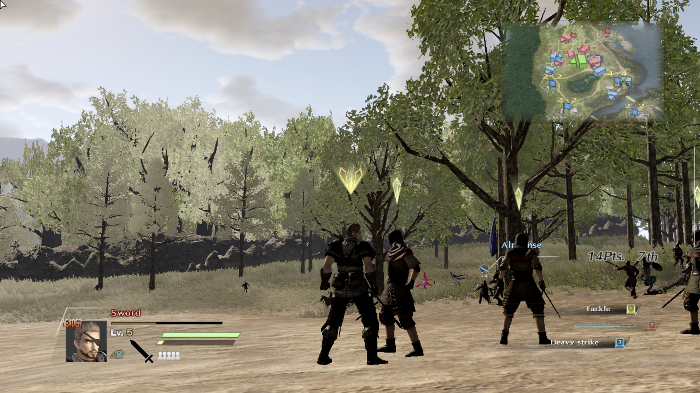
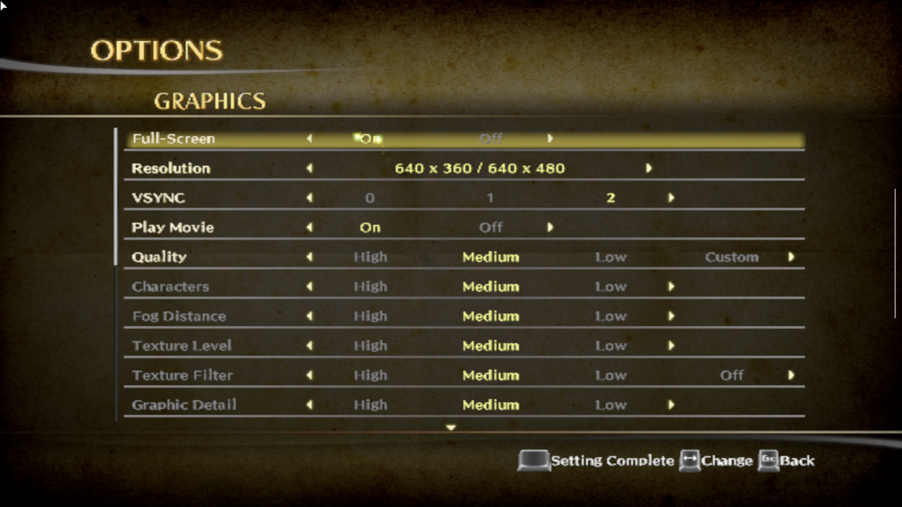
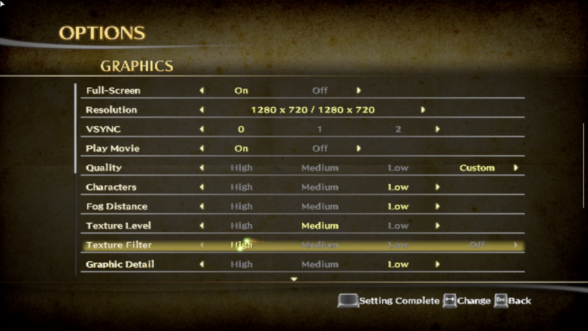
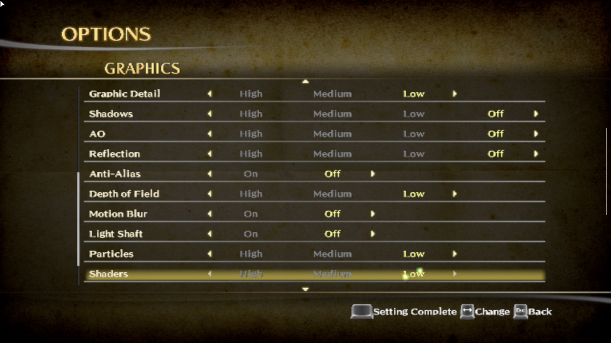
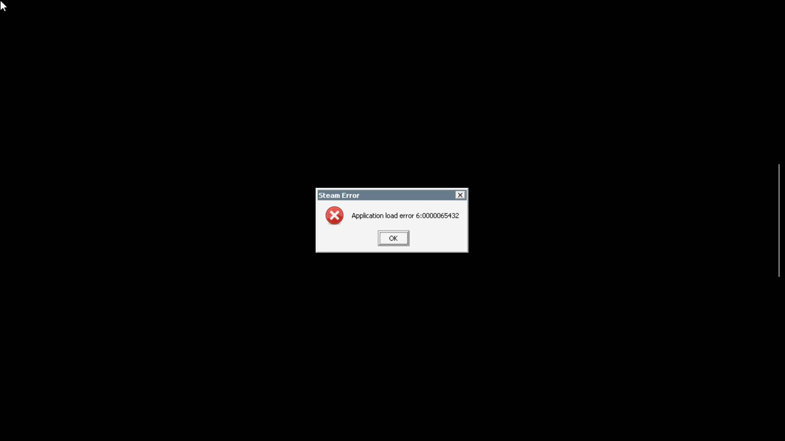

# Bladestorm: Nightmare on AYN Thor

Verified GameNative setup and graphics settings from an actual AYN Thor session on **October 27, 2026**.

The Steam release launched and played in the Normandy battle using **GameNative 1.3.0**, **Proton 9 ARM64EC**, and the settings below. The final short battle samples were **32.2-33.0 FPS**. This is one tested configuration, not a promise of that frame rate in every fight.

## What fixed it

1. **Steam launch failure:** enable **Launch Steam Client** for this game. It resolved `Application load error 6:0000065432`.
2. **Grainy, stretched picture:** change the game's own resolution to **1280 x 720**. Its original setting was `640 x 360 / 640 x 480`, even though the GameNative desktop was already 720p.
3. **Slow battles:** use the Custom graphics settings below, with fewer distant characters and expensive effects disabled. Select **Performance** in the Thor's Android quick settings and keep the fan on **Smart**.



## Restore the setup

### 1. GameNative

Use a legitimately installed Steam copy of [BLADESTORM: Nightmare, app 350310](https://store.steampowered.com/app/350310/).

Open its library entry, then **Options (gear) > Edit container**:

| Setting | Tested value |
| --- | --- |
| GameNative | 1.3.0 (`app.gamenative`) |
| Container Variant | bionic |
| Wine Version | `proton-9.0-arm64ec` |
| Executable Path | `Launch.exe` |
| Screen Size | 1280 x 720 |
| Launch Steam Client | On |
| Experimental Bionic Steam | Off |
| Use Legacy DRM | Off |
| Unpack Files | Off |
| Audio | PulseAudio |

**Save** the container configuration. The tested launch went from `Launch.exe` to `Launch_EA.exe`; keep the entry on `Launch.exe`.

The retained graphics setup logged **Wrapper**, **Turnip v26.2.0 R1**, and **cnc-ddraw**. These are the observed labels, not a recommendation to replace a working driver. The full observed emulation, CPU, environment and wrapper values are in [the settings snapshot](config/verified-settings.json). Fields such as `version=2.4.1` in its shared wrapper string do **not** establish which DXVK/VKD3D implementation was active. No driver/runtime comparison was performed.

The existing GameNative FPS limiter was left enabled at **60 FPS**. That is a ceiling, not an achieved frame rate. The temporary HUD and on-screen controller used during diagnosis were turned off afterward.

### 2. In-game graphics

From the game's title menu, open **Options > Graphics**. The **Settings** page inside a battle exposes gameplay options, not this graphics page.

Choose **Low** quality first, then **Custom**, then set the individual values below. Selecting a preset afterward replaces the individual settings.

<!-- SETTINGS:START -->
| Setting | Value |
| --- | --- |
| Full-Screen | On |
| Resolution (windowed / full-screen) | 1280 x 720 / 1280 x 720 |
| VSYNC | 0 |
| Play Movie | On |
| Quality | Custom (start from Low) |
| Characters | Low |
| Fog Distance | Low |
| Texture Level | Medium |
| Texture Filter | High |
| Graphic Detail | Low |
| Shadows | Off |
| AO | Off |
| Reflection | Off |
| Anti-Alias | Off |
| Depth of Field | Low |
| Motion Blur | Off |
| Light Shaft | Off |
| Particles | Low |
| Shaders | Low |
<!-- SETTINGS:END -->

Use **Setting Complete** (Space on the keyboard) to apply the settings. Configure **both** the GameNative desktop size and the game's own resolution; changing only the desktop does not fix a game rendering at 640 pixels wide.







### 3. Thor power mode

Expand Android quick settings, tap **Performance**, choose **Performance**, and tap **Done**. Leave **Fan > Smart** selected. This is the built-in Performance option; **High Performance** was not used. This setting applies to the device and can use more power than Standard.

## Troubleshooting

### Steam application load error

The reproduced error was **`6:0000065432`**. **Edit container > General > Launch Steam Client > On**, then Save and relaunch, fixed it. The log also reported a failed encrypted app-ticket request, but that log line alone did not prove the underlying cause. Successful launch was verified again after exiting and relaunching.



The separate **Unpack Files** toggle describes error **`3:0000065432`**. It was not needed for the `6:` error in this session. Leave it off when reproducing this setup.

### The picture is still soft

Check the in-game resolution first. A 720p GameNative desktop can still contain a 640-pixel game stretched to fit. Confirm that **Setting Complete** was used. Texture filtering was raised to High; motion blur was disabled. Anti-aliasing remains Off in this tested performance-oriented setup, so some edge shimmer can remain.

### Battle speed still varies

The final tested settings trade shadows, distant detail and crowd density for a sharper 720p picture and better speed. Large fights can still slow down. See [the verification record](docs/verification.md) for the actual samples and comparison limits. No frame generation, new APK, runtime replacement, or game-file patch was used.

### Saving before changing settings

Save through the game before returning to the title screen or restarting GameNative. A new manual save was created and checked in the save list during this session. Reloading it returned to the Normandy deployment screen, so this is **not** a guarantee of restoring the exact second or position inside a battle. Keep your own saves backed up separately.

## Files worth keeping

| File | Purpose |
| --- | --- |
| [config/verified-settings.json](config/verified-settings.json) | Machine-readable transcription of the verified settings and retained container values |
| [docs/verification.md](docs/verification.md) | Evidence, measured performance and what was not tested |
| [docs/performance-samples.csv](docs/performance-samples.csv) | Small, selected set of measured FPS/frame-time samples |
| [scripts/capture-diagnostics.ps1](scripts/capture-diagnostics.ps1) | Collect version, power mode, GameNative PowerMetrics and an optional screenshot through ADB |
| [scripts/update-settings-table.ps1](scripts/update-settings-table.ps1) | Regenerate/check this guide's graphics table from the JSON snapshot |

The JSON is **a manual restoration reference**, not a native GameNative import or a game INI file. Apply it through the menus above. Native container exports, the controller profile, game files, Steam credentials, raw logcat and saves are not included.

## Collect a future diagnostic snapshot

Use PowerShell 7 and Google's [Android SDK Platform-Tools](https://developer.android.com/tools/releases/platform-tools). Connect the Thor over USB, enable USB debugging, and authorize the computer on the device.

```powershell
pwsh -File .\scripts\capture-diagnostics.ps1 -AdbPath 'C:\Android\platform-tools\adb.exe'
```

If more than one device is connected, add `-Serial YOUR_DEVICE_SERIAL`. Add `-Screenshot` to capture the current game screen. Output goes under ignored `outputs/`. The helper reads device information; it does not change settings, start/stop the game, or press buttons. It reads only the `PowerMetrics` log tag rather than exporting full logcat. Check screenshots before sharing them.

For useful comparisons, use the same battle, location, camera and power mode, let shader/loading activity settle, and capture a similar period of actual fighting. A menu or loading screen is not a battle benchmark.

```powershell
# After editing the JSON, update the graphics table:
pwsh -File .\scripts\update-settings-table.ps1
# Or check it without changing files:
pwsh -File .\scripts\update-settings-table.ps1 -Check
```

See [ADB input notes](docs/adb-notes.md) if automating the game's menus.

## Upstream references

- [GameNative project](https://github.com/utkarshdalal/GameNative) and [tested v1.3.0 release](https://github.com/utkarshdalal/GameNative/releases/tag/v1.3.0)
- [Official Bladestorm Steam page](https://store.steampowered.com/app/350310/)
- [Official English manual](https://shared.akamai.steamstatic.com/store_item_assets/steam/apps/350310/manuals/steam%28digital%29_BSN-EN.pdf)

Screenshots are from the tested game session. Game content belongs to its respective rights holders. This repository is an independent setup record.
