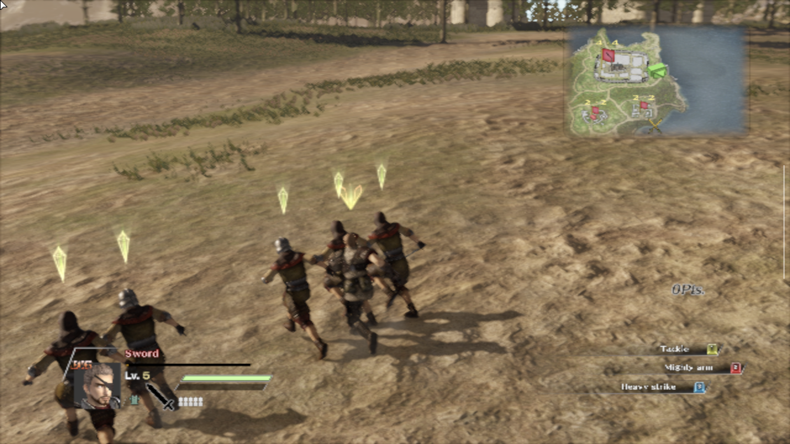

# Verification record

Test date: **October 27, 2026**, America/New_York. Device: **AYN Thor**, Android reporting SoC `QCS8550`. Game: Steam app **350310**. App: **GameNative 1.3.0**. Runtime: **Proton 9 ARM64EC**.

## Launch

With Launch Steam Client disabled, launching through `Launch.exe` reached a Steam dialog: `Application load error 6:0000065432`. The log also reported a failed encrypted app-ticket request.

Enabled **Launch Steam Client** for this game and saved the container configuration. The same entry reached the Koei Tecmo logo, opening movie, title screen and main menu. Exited normally and relaunched; the fix persisted. The user subsequently played the game with the Thor's controls.

No APK update, game reinstall, executable patch, legacy DRM toggle, Unpack Files toggle, or replacement runtime was needed.

## Image quality

The game's original Graphics page showed Full-Screen On, resolution `640 x 360 / 640 x 480`, VSYNC 2, and the Medium preset. GameNative's desktop was already 1280 x 720. Raising only the desktop therefore would not have addressed the game's low internal resolution.

Applied 1280 x 720 for both game modes and the Custom values in [the snapshot](../config/verified-settings.json). The applied menus and battlefield were visibly sharper. The user confirmed a substantial visual improvement during live play. The new settings survived a full game relaunch.

Before and after screenshots show different camera positions and moments; they demonstrate image quality, not a controlled performance A/B test.

## Performance

Read GameNative's on-device **PowerMetrics** output through ADB. These samples are application-reported FPS/frame-time measurements, not an external high-speed-camera or latency test.

| Phase | Observation |
| --- | --- |
| Earlier play, Medium/low resolution | Some logged samples fell to roughly 7-20 FPS; these include varying scenes and load |
| 720p Custom, Standard power | Moving-field samples around 26-33 FPS; not sustained worst-case combat |
| 720p Custom, Performance power | Four consecutive five-second reporting points: 32.7, 32.2, 33.0, 32.9 FPS |

The final four reporting points were at **08:24:23-08:24:38 EDT**. Their mean is **32.7 FPS**, with reported p95 frame times of **33.5-34.7 ms**. The metric's reporting cadence is approximately five seconds; this is not proof of a continuous five-second measurement window for each row.

The selected numerical samples are in [performance-samples.csv](performance-samples.csv). A 42.2 FPS transition sample was excluded from the final battle result. Menu/loading-screen samples near 60 FPS were also excluded. The GameNative limiter stayed enabled at 60 FPS; 60 was not a demonstrated sustained battle frame rate.

The earlier low-FPS samples and the final battle samples used different moments, camera positions and power modes. Do not present them as a controlled percentage improvement or a guarantee for every battle. Temperature, crowd size, shader compilation and longer sessions can affect performance.

## Settings provenance

- In-game graphics: read from the actual menus, changed through those menus, applied with Setting Complete, then verified through relaunch and battlefield rendering.
- Steam launch option/runtime/resolution: read from the GameNative UI and launch logs.
- Retained wrapper/CPU/emulation/environment values: transcribed from the launch block for **STEAM_350310**, including the successful Steam-client launch and the later relaunch. These were not independently optimized.
- Thor performance: changed from Standard to the built-in **Performance** option through Android quick settings; read back Android setting value `performance_mode=1`.
- Fan: Smart, retained. High Performance mode was not used.
- Physical controls: user played successfully; individual mappings were not exported or audited.

The logged wrapper label is `cnc-ddraw`, under graphics driver `Wrapper`, with Turnip v26.2.0 R1 in the driver path. The shared wrapper config contains DXVK/VKD3D-related version fields. These fields alone do not prove that either renderer was active. This record preserves the tested values without substituting an assumed renderer.

## Preservation and limits

A new manual Hundred Years' War save was created at **08:10:04 EDT** and its presence was checked in the save list. An earlier autosave remained available. Loading the manual save returned to Normandy deployment, then live battle. Saves stay on the user's device and are not published here.

The repository contains a settings transcription, not a native importable container/config backup. A fresh installation from an empty device was not tested. A native controller profile, every registry setting, and the private Wine prefix were not exported. Network/account configuration is not part of this repository.
